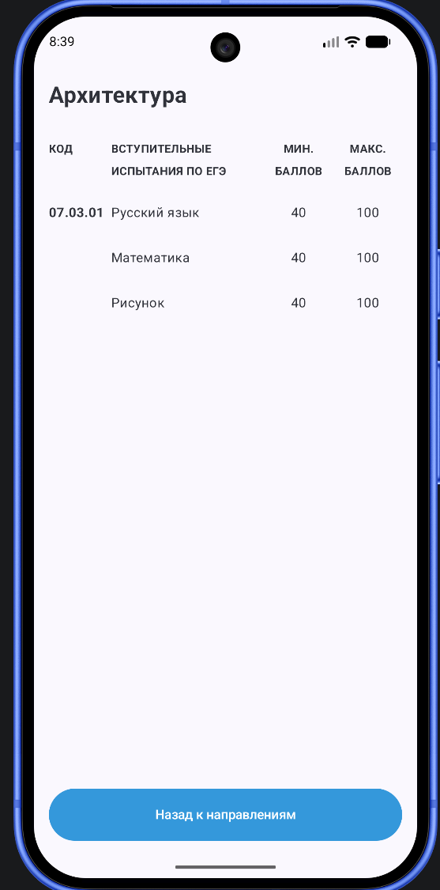
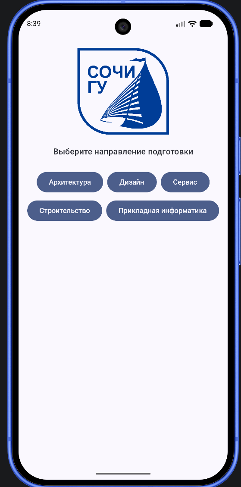

# Приложение «Поступление: Проходные баллы»

**Практическое задание для экзамена «Современные технологии программирования» (при наличии базового образования по 09.03.00), Магистратура 1 курс 1 семестр**

## 📱 Описание проекта
Данное мобильное приложение предназначено для абитуриентов и помогает ориентироваться в требованиях при поступлении в вуз. Написан один из функционала приложения.

**Основные возможности:**
* Просмотр полного списка вступительных испытаний (экзаменов) для выбранного направления подготовки.
* Отображение минимальных и максимальных проходных баллов по каждому предмету.

## 📸 Скриншоты приложения

| Главный экран (Список направлений) | Экран с деталями (Баллы и экзамены) |
| :---: | :---: |
|  |  |
